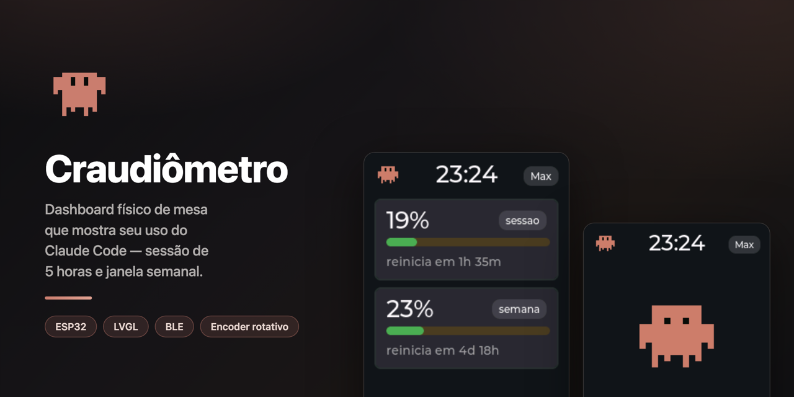
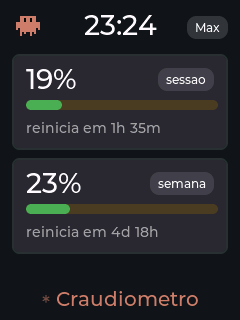
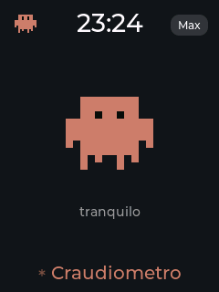
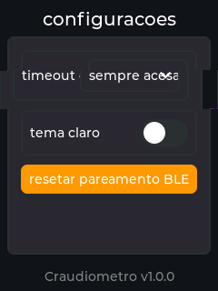
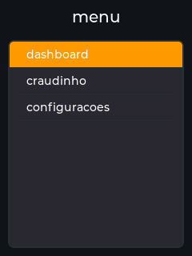
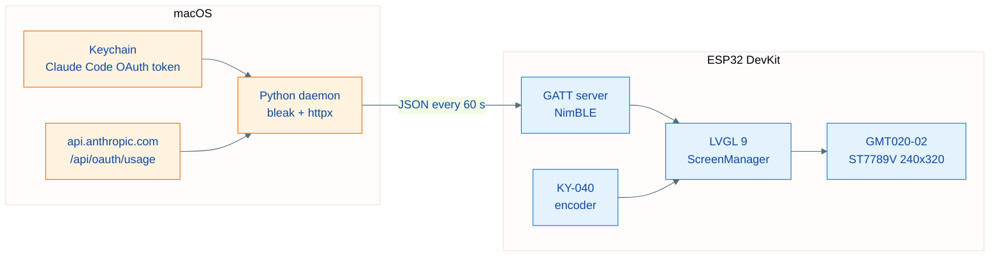

<h1 align="center">Craudiômetro</h1>

<p align="center">A physical desk dashboard that shows your Claude Code usage in real time.</p>

<p align="center">
  
  
  
  
</p>

<p align="center"><a href="README.md">Leia em português</a></p>

<p align="center">
  
</p>

Craudiômetro is a hardware usage monitor for Claude Code: it displays the
5-hour session and the weekly window on an ESP32 with a color display,
navigated with a rotary encoder. A Python daemon on macOS reads your usage
from the Anthropic API and streams it to the device over Bluetooth Low Energy
(BLE). The project mascot is Craudinho, a pixel-art take on the Claude Code
mascot that animates with your usage intensity — and falls asleep when the
daemon is off.

Conceptually inspired by [Clawdmeter](https://github.com/HermannBjorgvin/Clawdmeter).
No code or asset from that project was copied (it has no open-source license):
the protocol, firmware, daemon and artwork were all built from scratch for
this repository.

| Dashboard | Craudinho | Settings | Menu |
| --- | --- | --- | --- |
|  |  |  |  |

Real captures from the device, taken over serial with `tools/screenshot.py`
(see [Device screenshots](#device-screenshots)).

## Architecture



## Hardware

| Component | Model |
| --- | --- |
| Microcontroller | ESP32 DevKit (WROOM-32) |
| Display | GMT020-02-7P ver 1.3 (2.0" IPS, ST7789V, 240x320, SPI) |
| Encoder | KY-040 (rotary with push button) |

### Display wiring

| Display | ESP32 | Function |
| --- | --- | --- |
| VCC | 3V3 | Power |
| GND | GND | Ground |
| SCL | GPIO 18 | SPI clock |
| SDA | GPIO 23 | SPI data (MOSI) |
| RST | GPIO 4 | Reset |
| DC | GPIO 2 | Data/Command |
| CS | GPIO 5 | Chip select |

If colors look inverted, flip `CRAUDIO_DISPLAY_INVERT` to `0` in
`firmware/platformio.ini` (panel batches vary).

### Encoder wiring

| Encoder | ESP32 | Function |
| --- | --- | --- |
| CLK | GPIO 32 | Quadrature A |
| DT | GPIO 33 | Quadrature B |
| SW | GPIO 25 | Button |
| + | 3V3 | Module pull-ups |
| GND | GND | Ground |

## Navigation

| Action | Effect |
| --- | --- |
| Rotate | Moves focus between widgets/items |
| Short press | Selects / confirms |
| Long press (0.8 s) | Opens the global menu; inside the menu, goes back |

v1 screens: dashboard (5-hour session + week with countdowns), craudio
(animated mascot), settings (screen timeout, theme, BLE pairing reset) and the
global menu — generated automatically from the screen registry in
`firmware/src/main.cpp`.

## Supported boards

The firmware builds for two boards. Each one has its own driver files
(`firmware/src/drivers/*_Esp32Dev.cpp` / `*_C6Lcd147.cpp`), selected via
`build_src_filter` per environment in `firmware/platformio.ini` — one
board's files never enter the other's build. `pio run`/`pio run -t upload`
without `-e` always targets the ESP32 DevKit (default); the new board
requires an explicit `-e esp32-c6-lcd-147`.

### Waveshare ESP32-C6-LCD-1.47-H

Its ST7789 display (172x320) is already built into the board — no wiring
needed. There's no onboard rotary encoder: navigation uses only the BOOT
button (GPIO9), with the encoder signals synthesized from click cadence:

| Action | Effect |
| --- | --- |
| Single click | Advances focus between widgets/items (like "rotate"; forward only) |
| Double click (within ~350 ms) | Selects / confirms |
| Long press (0.8 s) | Opens the global menu; inside the menu, goes back |

```bash
cd firmware
pio run -e esp32-c6-lcd-147            # build
pio run -e esp32-c6-lcd-147 -t upload  # flash over USB
pio device monitor -e esp32-c6-lcd-147 # serial log (native USB-CDC, 115200)
```

Uses the [pioarduino](https://github.com/pioarduino/platform-espressif32)
platform (community fork with Arduino support for ESP32-C6; PlatformIO's
official platform doesn't support it yet) — downloaded automatically on the
first `pio run` for that environment, no extra manual step.

## Firmware

Requirements: [PlatformIO](https://platformio.org/) (`brew install platformio`).

```bash
cd firmware
pio run                 # build
pio run -t upload       # flash over USB
pio device monitor      # serial log (115200)
```

Stack: Arduino + LVGL 9 + LovyanGFX (ST7789 with DMA) + NimBLE + ArduinoJson.

## Daemon (macOS)

The daemon reads the Claude Code OAuth token from the Keychain (service
`Claude Code-credentials`), queries `GET /api/oauth/usage` (costs no tokens)
and writes the result to the device over BLE every 60 seconds.

```bash
cd daemon
./install.sh    # bundle + venv in ~/.craudiometro + LaunchAgent (starts at login)
./uninstall.sh  # removes everything
```

The installer needs a Python with a real binary (the Xcode stub cannot create
a venv with `--copies`). If the default `python3` fails, point to another one:

```bash
PYTHON=/opt/homebrew/opt/python@3.13/bin/python3.13 ./install.sh
```

- Logs: `~/Library/Logs/craudiometro.log`
- The daemon runs inside a minimal `Craudiometro.app` bundle: without the
  `NSBluetoothAlwaysUsageDescription` in Info.plist, macOS kills launchd
  processes that touch Bluetooth without even showing the permission prompt.
- On first run, approve the Bluetooth prompt for "Craudiômetro". If you deny
  it by mistake, reset the decision and restart the daemon:

  ```bash
  tccutil reset BluetoothAlways com.craudiometro.daemon
  launchctl kickstart -k gui/$(id -u)/com.craudiometro.daemon
  ```

- If the Keychain token expires, the daemon signals the failure to the device
  and recovers by itself the next time Claude Code refreshes the token.

### BLE protocol

Service `6a485858-14a2-4918-9841-d3c2d2474fbc`, write characteristic
`23aefc82-8cba-470b-ba8f-d1c54f9f0656`, advertising name `craudiometro`.
JSON payload:

| Field | Meaning |
| --- | --- |
| `s` | 5-hour session utilization (0-100) |
| `sr` | Minutes until session reset |
| `w` | Weekly utilization (0-100) |
| `wr` | Minutes until weekly reset |
| `st` | Status (`allowed` when everything is normal) |
| `ok` | API collection succeeded |
| `pl` | Account plan name (e.g. `Max`) |
| `tm` | Minutes since midnight in the Mac's timezone (clock base) |

## Craudinho (mascot)

A pixel-art take on the Claude Code mascot (Clawd, by Anthropic), drawn from
scratch by script — no third-party asset files are used. The original mascot
belongs to Anthropic; this rendition is meant for personal use on the device.

```bash
python3 tools/gen_craudio_sprites.py   # draws the PNGs into assets/craudio/
python3 tools/png2lvgl.py              # converts them to LVGL C arrays (I4)
```

States: sleeping (no daemon), calm (< 30%), working (30-70%) and frantic
(> 70%), using the highest utilization between session and week. The same
drawing, at 32x32, is the header icon on the home screen.

## Device screenshots

The firmware accepts commands over Serial: `shot` streams the rendered screen
(SNAP protocol, RGB565) and `screen <name>` switches screens. The script
reassembles the PNGs — real display pixels, with real data:

```bash
python3 -m venv .venv && .venv/bin/pip install pyserial pillow   # once
.venv/bin/python tools/screenshot.py --all --out-dir docs/screenshots
```

Opening the serial port resets the ESP32 (the CH340 driver toggles DTR); the
script waits for boot and the first BLE payload before capturing, and merges
refresh cycles until the whole screen is covered.

## How to add a new screen

1. Create a class inheriting from `Screen` in `firmware/src/screens/`.
2. Implement `name()`, `create()` and, if it needs data, `onStateChanged()`.
3. Register the instance with `manager.registerScreen(...)` in `main.cpp`.

The global menu lists the screen automatically.

## Contributing

Contributions are welcome: issues, fixes, new screens and artwork
improvements. For large changes, open an issue before the PR to align on the
idea.

### Where to work

| Area | Where | Stack |
| --- | --- | --- |
| Firmware (UI, BLE, screens) | `firmware/` | Arduino + LVGL 9 + LovyanGFX + NimBLE |
| Collection daemon (macOS) | `daemon/` | Python 3 (bleak, httpx, rumps) |
| Mascot artwork | `tools/gen_craudio_sprites.py` | Python + Pillow |
| Screenshot capture | `tools/screenshot.py` | pyserial + Pillow |

### Workflow

1. Fork and create a branch off `main`.
2. Firmware: `cd firmware && pio run` must build clean. UI or BLE changes
   should be tested on the device (`pio run -t upload`).
3. Daemon: run in the foreground to debug:

   ```bash
   cd daemon
   python3 -m venv .venv && .venv/bin/pip install -r requirements.txt
   .venv/bin/python craudiometro_daemon.py
   ```

4. Changed an existing screen? Regenerate the README captures with
   `tools/screenshot.py` (see [Device screenshots](#device-screenshots)).
5. New screen? Follow [How to add a new screen](#how-to-add-a-new-screen).

### Conventions

- Commits: Conventional Commits in pt-BR (`feat:`, `fix:`, `docs:`, ...),
  verbs in the infinitive, no emojis.
- Code and identifiers in English; documentation in pt-BR (this English
  README is the exception, kept in sync with the Portuguese one).
- Diagrams in Mermaid; no emojis in code, UI or documentation.
- Do not include third-party assets: all artwork is generated by script (see
  [Craudinho (mascot)](#craudinho-mascot)).

By contributing, you agree that your contribution is licensed under the
project's [MIT license](LICENSE).

## License

Distributed under the MIT license — see [LICENSE](LICENSE).
