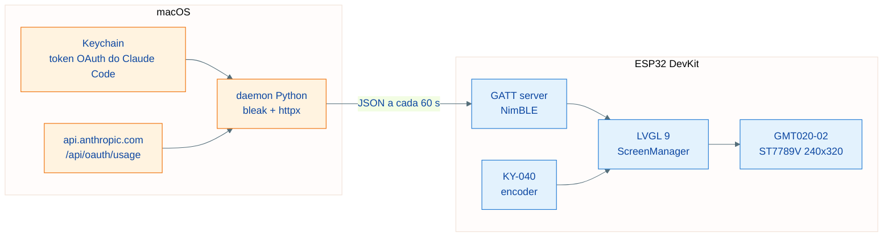

# Craudiometro

Dashboard fisico de mesa que mostra o uso do Claude Code (sessao de 5 horas e
janela semanal) num ESP32 com display colorido, navegado por um encoder
rotativo. O mascote do projeto e o Craudinho, releitura pixel-art do mascote
do Claude Code que anima conforme a intensidade de uso — e dorme quando o
daemon esta desligado.

Inspirado conceitualmente no [Clawdmeter](https://github.com/HermannBjorgvin/Clawdmeter).
Nenhum codigo ou asset daquele projeto foi copiado (ele nao possui licenca
open-source): protocolo, firmware, daemon e arte foram criados do zero para
este repositorio.

## Arquitetura



## Hardware

| Componente | Modelo |
| --- | --- |
| Microcontrolador | ESP32 DevKit (WROOM-32) |
| Display | GMT020-02-7P ver 1.3 (IPS 2.0", ST7789V, 240x320, SPI) |
| Encoder | KY-040 (rotativo com botao) |

### Fiacao do display

| Display | ESP32 | Funcao |
| --- | --- | --- |
| VCC | 3V3 | Alimentacao |
| GND | GND | Terra |
| SCL | GPIO 18 | SPI clock |
| SDA | GPIO 23 | SPI data (MOSI) |
| RST | GPIO 4 | Reset |
| DC | GPIO 2 | Data/Command |
| CS | GPIO 5 | Chip select |

Se as cores aparecerem em negativo, troque `CRAUDIO_DISPLAY_INVERT` para `0`
em `firmware/platformio.ini` (ha variacoes entre lotes do painel).

### Fiacao do encoder

| Encoder | ESP32 | Funcao |
| --- | --- | --- |
| CLK | GPIO 32 | Quadratura A |
| DT | GPIO 33 | Quadratura B |
| SW | GPIO 25 | Botao |
| + | 3V3 | Pull-ups do modulo |
| GND | GND | Terra |

## Navegacao

| Acao | Efeito |
| --- | --- |
| Girar | Move o foco entre widgets/itens |
| Clique curto | Seleciona / confirma |
| Clique longo (0,8 s) | Abre o menu global; dentro do menu, volta |

Telas da v1: dashboard (sessao 5h + semana com countdowns), craudio (mascote
animado), configuracoes (timeout de tela, tema, reset de pareamento BLE) e o
menu global — gerado automaticamente do registro de telas em
`firmware/src/main.cpp`.

## Firmware

Requisitos: [PlatformIO](https://platformio.org/) (`brew install platformio`).

```bash
cd firmware
pio run                 # compila
pio run -t upload       # flasha via USB
pio device monitor      # log serial (115200)
```

Stack: Arduino + LVGL 9 + LovyanGFX (ST7789 com DMA) + NimBLE + ArduinoJson.

## Daemon (macOS)

O daemon le o token OAuth do Claude Code no Keychain (service
`Claude Code-credentials`), consulta `GET /api/oauth/usage` (sem custo de
tokens) e grava o resultado no dispositivo via BLE a cada 60 segundos.

```bash
cd daemon
./install.sh    # bundle + venv em ~/.craudiometro + LaunchAgent (inicia no login)
./uninstall.sh  # remove tudo
```

O instalador precisa de um Python com binario real (o stub do Xcode nao cria
venv com `--copies`). Se o `python3` padrao falhar, indique outro:

```bash
PYTHON=/opt/homebrew/opt/python@3.13/bin/python3.13 ./install.sh
```

- Logs: `~/Library/Logs/craudiometro.log`
- O daemon roda dentro de um bundle `Craudiometro.app` minimo: sem o
  `NSBluetoothAlwaysUsageDescription` do Info.plist, o macOS aborta processos
  do launchd que tocam Bluetooth sem nem exibir o prompt de permissao.
- Na primeira execucao, aprove o prompt de Bluetooth do "Craudiometro". Se
  negar por engano, resete a decisao e reinicie o daemon:

  ```bash
  tccutil reset BluetoothAlways com.craudiometro.daemon
  launchctl kickstart -k gui/$(id -u)/com.craudiometro.daemon
  ```

- Se o token do Keychain expirar, o daemon sinaliza falha ao dispositivo e se
  recupera sozinho na proxima vez que o Claude Code renovar o token.

### Protocolo BLE

Service `6a485858-14a2-4918-9841-d3c2d2474fbc`, characteristic de escrita
`23aefc82-8cba-470b-ba8f-d1c54f9f0656`, nome de advertising `craudiometro`.
Payload JSON:

| Campo | Significado |
| --- | --- |
| `s` | Utilizacao da sessao 5h (0-100) |
| `sr` | Minutos ate o reset da sessao |
| `w` | Utilizacao da semana (0-100) |
| `wr` | Minutos ate o reset semanal |
| `st` | Status (`allowed` quando tudo normal) |
| `ok` | Coleta na API bem-sucedida |
| `pl` | Nome do plano da conta (ex.: `Max`) |
| `tm` | Minutos desde a meia-noite no fuso do Mac (base do relogio) |

## Craudinho (mascote)

Releitura pixel-art do mascote do Claude Code (Clawd, da Anthropic), desenhada
do zero por script — nenhum arquivo de asset de terceiros e usado. O mascote
original pertence a Anthropic; esta releitura destina-se a uso pessoal no
dispositivo.

```bash
python3 tools/gen_craudio_sprites.py   # desenha os PNGs em assets/craudio/
python3 tools/png2lvgl.py              # converte para arrays C do LVGL (I4)
```

Estados: dormindo (sem daemon), tranquilo (< 30%), trabalhando (30-70%) e
frenetico (> 70%), usando a maior utilizacao entre sessao e semana. O mesmo
desenho, em 32x32, e o icone do header da tela inicial.

## Como adicionar uma tela nova

1. Crie uma classe que herda de `Screen` em `firmware/src/screens/`.
2. Implemente `name()`, `create()` e, se precisar de dados, `onStateChanged()`.
3. Registre a instancia com `manager.registerScreen(...)` em `main.cpp`.

O menu global lista a tela automaticamente.
