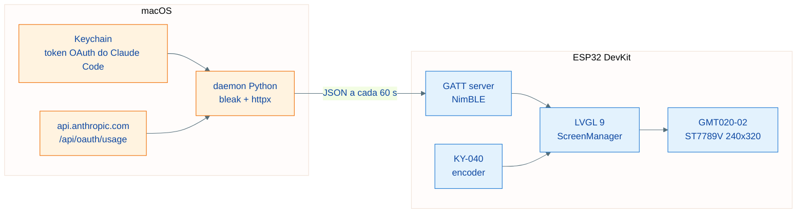

<h1 align="center">Craudiômetro</h1>

<p align="center">Dashboard físico de mesa que mostra, em tempo real, o uso do Claude Code.</p>

<p align="center">
  
  
  
  
</p>

<p align="center"><a href="README.en.md">Read in English</a></p>

<p align="center">
  
</p>

O Craudiômetro exibe a sessão de 5 horas e a janela semanal do Claude Code num
ESP32 com display colorido, navegado por um encoder rotativo. O mascote do
projeto é o Craudinho, releitura pixel-art do mascote do Claude Code que anima
conforme a intensidade de uso — e dorme quando o daemon está desligado.

Inspirado conceitualmente no [Clawdmeter](https://github.com/HermannBjorgvin/Clawdmeter).
Nenhum código ou asset daquele projeto foi copiado (ele não possui licença
open-source): protocolo, firmware, daemon e arte foram criados do zero para
este repositório.

| Dashboard | Craudinho | Configurações | Menu |
| --- | --- | --- | --- |
|  |  |  |  |

Capturas reais do dispositivo, tiradas pela serial com `tools/screenshot.py`
(ver [Screenshots do dispositivo](#screenshots-do-dispositivo)).

## Arquitetura



## Hardware

| Componente | Modelo |
| --- | --- |
| Microcontrolador | ESP32 DevKit (WROOM-32) |
| Display | GMT020-02-7P ver 1.3 (IPS 2.0", ST7789V, 240x320, SPI) |
| Encoder | KY-040 (rotativo com botão) |

### Fiação do display

| Display | ESP32 | Função |
| --- | --- | --- |
| VCC | 3V3 | Alimentação |
| GND | GND | Terra |
| SCL | GPIO 18 | SPI clock |
| SDA | GPIO 23 | SPI data (MOSI) |
| RST | GPIO 4 | Reset |
| DC | GPIO 2 | Data/Command |
| CS | GPIO 5 | Chip select |

Se as cores aparecerem em negativo, troque `CRAUDIO_DISPLAY_INVERT` para `0`
em `firmware/platformio.ini` (há variações entre lotes do painel).

### Fiação do encoder

| Encoder | ESP32 | Função |
| --- | --- | --- |
| CLK | GPIO 32 | Quadratura A |
| DT | GPIO 33 | Quadratura B |
| SW | GPIO 25 | Botão |
| + | 3V3 | Pull-ups do módulo |
| GND | GND | Terra |

## Navegação

| Ação | Efeito |
| --- | --- |
| Girar | Move o foco entre widgets/itens |
| Clique curto | Seleciona / confirma |
| Clique longo (0,8 s) | Abre o menu global; dentro do menu, volta |

Telas da v1: dashboard (sessão 5h + semana com countdowns), craudio (mascote
animado), configurações (timeout de tela, tema, reset de pareamento BLE) e o
menu global — gerado automaticamente do registro de telas em
`firmware/src/main.cpp`.

## Placas suportadas

O firmware compila para dois boards. Cada um tem seus próprios arquivos de
driver (`firmware/src/drivers/*_Esp32Dev.cpp` / `*_C6Lcd147.cpp`),
selecionados por `build_src_filter` por ambiente em
`firmware/platformio.ini` — um board nunca entra no build do outro.
`pio run`/`pio run -t upload` sem `-e` sempre mira o ESP32 DevKit (padrão);
o board novo exige `-e esp32-c6-lcd-147` explícito.

### Waveshare ESP32-C6-LCD-1.47-H

Display ST7789 (172x320) já embutido na placa — sem fiação nenhuma. Sem
encoder rotativo onboard: a navegação usa só o botão BOOT (GPIO9), com os
sinais do encoder sintetizados pela cadência do clique:

| Ação | Efeito |
| --- | --- |
| Clique simples | Avança o foco entre widgets/itens (equivalente a "girar"; só para frente) |
| Clique duplo (até ~350 ms entre os dois) | Seleciona / confirma |
| Clique longo (0,8 s) | Abre o menu global; dentro do menu, volta |

```bash
cd firmware
pio run -e esp32-c6-lcd-147            # compila
pio run -e esp32-c6-lcd-147 -t upload  # flasha via USB
pio device monitor -e esp32-c6-lcd-147 # log serial (USB-CDC nativo, 115200)
```

Usa o platform [pioarduino](https://github.com/pioarduino/platform-espressif32)
(fork da comunidade com suporte a Arduino no ESP32-C6; o oficial da
PlatformIO ainda não suporta) — baixado automaticamente no primeiro `pio run`
desse ambiente, sem passo manual extra.

## Firmware

Requisitos: [PlatformIO](https://platformio.org/) (`brew install platformio`).

```bash
cd firmware
pio run                 # compila
pio run -t upload       # flasha via USB
pio device monitor      # log serial (115200)
```

Stack: Arduino + LVGL 9 + LovyanGFX (ST7789 com DMA) + NimBLE + ArduinoJson.

## Daemon (macOS)

O daemon lê o token OAuth do Claude Code no Keychain (service
`Claude Code-credentials`), consulta `GET /api/oauth/usage` (sem custo de
tokens) e grava o resultado no dispositivo via BLE a cada 60 segundos.

```bash
cd daemon
./install.sh    # bundle + venv em ~/.craudiometro + LaunchAgent (inicia no login)
./uninstall.sh  # remove tudo
```

O instalador precisa de um Python com binário real (o stub do Xcode não cria
venv com `--copies`). Se o `python3` padrão falhar, indique outro:

```bash
PYTHON=/opt/homebrew/opt/python@3.13/bin/python3.13 ./install.sh
```

- Logs: `~/Library/Logs/craudiometro.log`
- O daemon roda dentro de um bundle `Craudiometro.app` mínimo: sem o
  `NSBluetoothAlwaysUsageDescription` do Info.plist, o macOS aborta processos
  do launchd que tocam Bluetooth sem nem exibir o prompt de permissão.
- Na primeira execução, aprove o prompt de Bluetooth do "Craudiômetro". Se
  negar por engano, resete a decisão e reinicie o daemon:

  ```bash
  tccutil reset BluetoothAlways com.craudiometro.daemon
  launchctl kickstart -k gui/$(id -u)/com.craudiometro.daemon
  ```

- Se o token do Keychain expirar, o daemon sinaliza falha ao dispositivo e se
  recupera sozinho na próxima vez que o Claude Code renovar o token.

### Protocolo BLE

Service `6a485858-14a2-4918-9841-d3c2d2474fbc`, characteristic de escrita
`23aefc82-8cba-470b-ba8f-d1c54f9f0656`, nome de advertising `craudiometro`.
Payload JSON:

| Campo | Significado |
| --- | --- |
| `s` | Utilização da sessão 5h (0-100) |
| `sr` | Minutos até o reset da sessão |
| `w` | Utilização da semana (0-100) |
| `wr` | Minutos até o reset semanal |
| `st` | Status (`allowed` quando tudo normal) |
| `ok` | Coleta na API bem-sucedida |
| `pl` | Nome do plano da conta (ex.: `Max`) |
| `tm` | Minutos desde a meia-noite no fuso do Mac (base do relógio) |

## Craudinho (mascote)

Releitura pixel-art do mascote do Claude Code (Clawd, da Anthropic), desenhada
do zero por script — nenhum arquivo de asset de terceiros é usado. O mascote
original pertence à Anthropic; esta releitura destina-se a uso pessoal no
dispositivo.

```bash
python3 tools/gen_craudio_sprites.py   # desenha os PNGs em assets/craudio/
python3 tools/png2lvgl.py              # converte para arrays C do LVGL (I4)
```

Estados: dormindo (sem daemon), tranquilo (< 30%), trabalhando (30-70%) e
frenético (> 70%), usando a maior utilização entre sessão e semana. O mesmo
desenho, em 32x32, é o ícone do header da tela inicial.

## Screenshots do dispositivo

O firmware aceita comandos pela Serial: `shot` transmite a tela renderizada
(protocolo SNAP, RGB565) e `screen <nome>` troca de tela. O script remonta os
PNGs — pixels reais do display, com dados reais:

```bash
python3 -m venv .venv && .venv/bin/pip install pyserial pillow   # uma vez
.venv/bin/python tools/screenshot.py --all --out-dir docs/screenshots
```

Abrir a porta serial reseta o ESP32 (o driver do CH340 aciona o DTR); o script
espera o boot e o primeiro payload BLE antes de capturar, e mescla ciclos de
refresh até cobrir a tela inteira.

## Como adicionar uma tela nova

1. Crie uma classe que herda de `Screen` em `firmware/src/screens/`.
2. Implemente `name()`, `create()` e, se precisar de dados, `onStateChanged()`.
3. Registre a instância com `manager.registerScreen(...)` em `main.cpp`.

O menu global lista a tela automaticamente.

## Como colaborar

Contribuições são bem-vindas: issues, correções, telas novas e melhorias na
arte. Para mudanças grandes, abra uma issue antes do PR para alinhar a ideia.

### Onde mexer

| Área | Onde | Stack |
| --- | --- | --- |
| Firmware (UI, BLE, telas) | `firmware/` | Arduino + LVGL 9 + LovyanGFX + NimBLE |
| Daemon de coleta (macOS) | `daemon/` | Python 3 (bleak, httpx, rumps) |
| Arte do mascote | `tools/gen_craudio_sprites.py` | Python + Pillow |
| Captura de screenshots | `tools/screenshot.py` | pyserial + Pillow |

### Fluxo

1. Faça fork e crie um branch a partir de `main`.
2. Firmware: `cd firmware && pio run` precisa compilar limpo. Mudanças de UI ou
   BLE devem ser testadas no dispositivo (`pio run -t upload`).
3. Daemon: rode em foreground para depurar:

   ```bash
   cd daemon
   python3 -m venv .venv && .venv/bin/pip install -r requirements.txt
   .venv/bin/python craudiometro_daemon.py
   ```

4. Mudou uma tela existente? Regenere as capturas do README com
   `tools/screenshot.py` (ver [Screenshots do dispositivo](#screenshots-do-dispositivo)).
5. Tela nova? Siga [Como adicionar uma tela nova](#como-adicionar-uma-tela-nova).

### Convenções

- Commits: Conventional Commits em pt-BR (`feat:`, `fix:`, `docs:`, ...), com
  verbo no infinitivo e sem emojis.
- Código e identificadores em inglês; documentação em pt-BR.
- Diagramas em Mermaid; sem emojis em código, UI ou documentação.
- Não inclua assets de terceiros: toda a arte é gerada por script (ver
  [Craudinho (mascote)](#craudinho-mascote)).

Ao contribuir, você concorda que sua contribuição seja licenciada sob a
[licença MIT](LICENSE) do projeto.

## Licença

Distribuído sob a licença MIT — veja [LICENSE](LICENSE).
